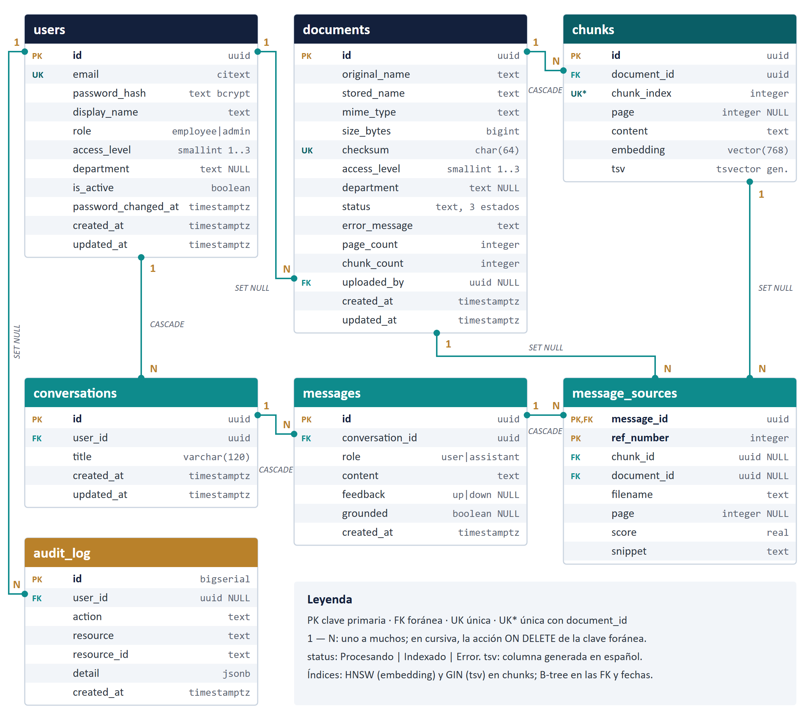
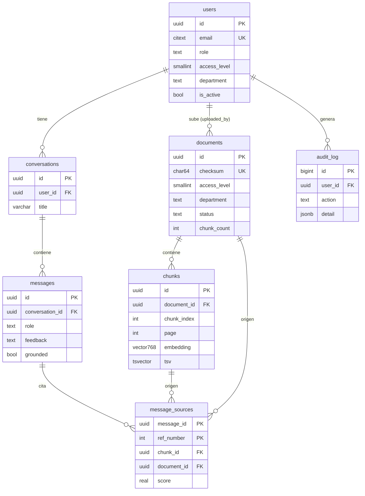

# Base de datos de DocuLocal

PostgreSQL 17 con pgvector, citext y pgcrypto. El esquema completo está en `schema.sql`.





## Crear la base

1. Copia `.env.example` a `.env` (trae valores de desarrollo).
2. Desde la raíz del repo: `docker compose up -d db`

Al crearse el volumen por primera vez, Postgres ejecuta `db/schema.sql` automáticamente.

## Recrearla desde cero (borra todos los datos)

```
docker compose down -v
docker compose up -d db
```
